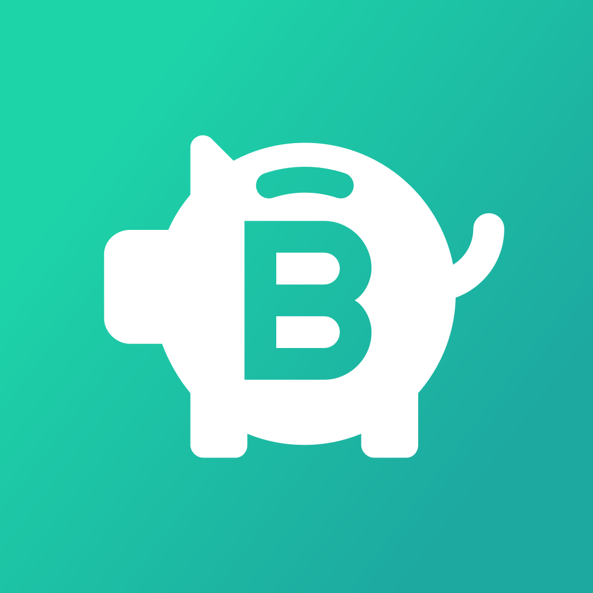
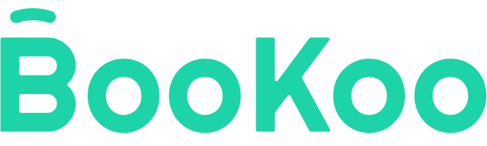

 
 

### The shared ledger for the people you spend with

**Make money more valuable through transparency.**

 

&nbsp;

 
 

[Website](https://bookoo.hyo.dev) · [Support](https://bookoo.hyo.dev/support) · [Privacy](https://bookoo.hyo.dev/legal/privacy) · [Terms](https://bookoo.hyo.dev/legal/terms)

---

## Why BooKoo

Couples, families, roommates, clubs and travel groups share money every day,
but rarely share the same picture of it. BooKoo gives everyone in the group one
ledger: each person records what they spend or receive, and everyone sees the
same entries, totals and conversations — live.

## What you can do

- 👥 **Share one ledger** — invite people with a link; owners, admins and
  members each get the right permissions.
- ✍️ **Record in seconds** — income and expenses with a category, memo, photo
  and place.
- 💬 **Talk about it** — comment on any entry, so questions get answered where
  the money is.
- 📅 **See the month** — a calendar view and a timeline of every entry.
- 📊 **Understand spending** — monthly totals and category statistics, always
  up to date.
- 🔒 **Keep it private** — app lock, and a ledger only the people you invite
  can see.
- 🌏 **Use your language** — Korean, English, Japanese, Chinese, Indonesian,
  Vietnamese, German, Spanish, French, Italian, Dutch and Portuguese.

## Free and Pro

**Free is a complete ledger, not a trial.** Unlimited entries, categories,
calendar, statistics, photos, comments and export are free, and joining a
ledger someone else pays for is always free.

**Pro removes ads and opens more room for the group:** an ad-free ledger for
the subscriber and everyone invited to it, plus additional shared ledgers for
separate groups, trips or goals.

Reading, exporting and deleting your own data is never paywalled. The full
policy is in [`docs/product/MONETIZATION.md`](./docs/product/MONETIZATION.md).

## Transparent by design

- **Inside a ledger** — everyone invited sees the same facts.
- **The app itself** — this repository is the app. Anyone can read how
  permissions are checked, how data is stored and where ads may appear.
- **The project** — BooKoo is an open startup. Revenue, costs and aggregate
  usage are published in [`OPEN_STARTUP.md`](./OPEN_STARTUP.md).

Transparency stops at the ledger boundary: your ledger is visible only to the
people you invite. Open code never means open data.

## Help and feedback

- Questions or problems: [bookoo.hyo.dev/support](https://bookoo.hyo.dev/support)
- Delete your account: [bookoo.hyo.dev/account-deletion](https://bookoo.hyo.dev/account-deletion)
- Found a bug? [Open an issue](https://github.com/hyodotdev/BooKoo/issues).
  Please never post screenshots that show real ledgers or personal details.

## For developers

BooKoo is built with Expo, React Native and Convex. Setup, architecture,
scripts and contribution rules are in [`CONTRIBUTING.md`](./CONTRIBUTING.md).

## License

The code is licensed under the
[GNU Affero General Public License v3.0](./LICENSE) (`AGPL-3.0-only`).
The BooKoo name, logo, app icon and store artwork are not covered by that
license — see [`TRADEMARKS.md`](./TRADEMARKS.md).
